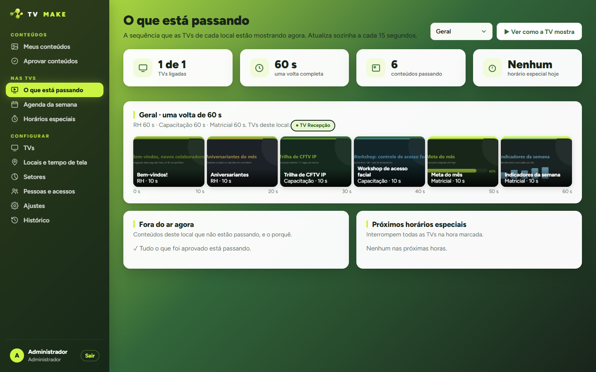
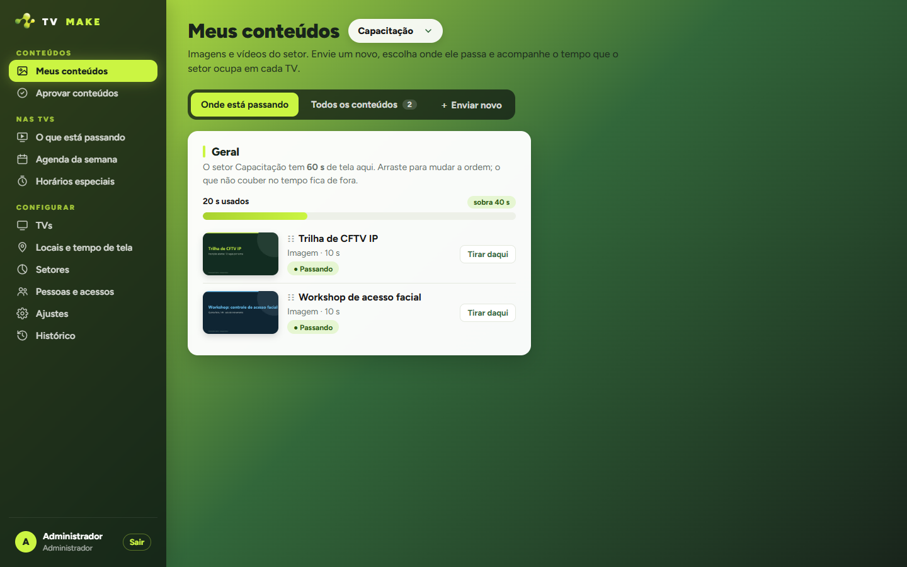
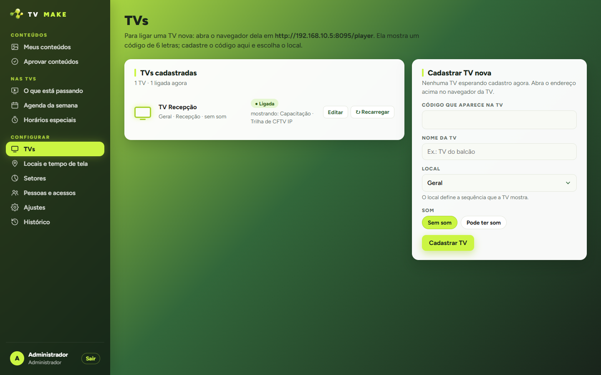
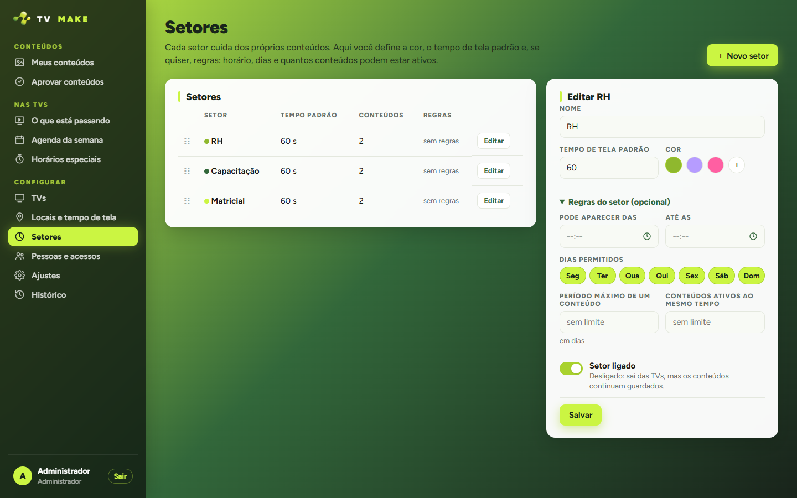
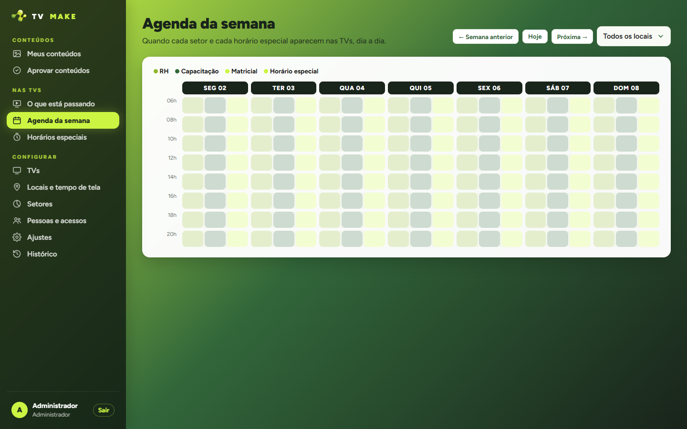

# TV Make

**Sinalização digital interna: o que cada setor publica, passando nas TVs da empresa.**

Os setores enviam imagens e vídeos. Cada TV mostra a sequência do seu local, com tempo de tela por setor e horários especiais que entram na hora marcada.

> Este repositório é uma vitrine. O sistema roda na rede interna da empresa; o código e os dados são privados.
> As telas abaixo são de um ambiente de demonstração, com conteúdo fictício.

## As telas

**O que está passando.** A volta completa de cada local, as TVs ligadas e, quando algo não entra, o motivo.

<table>
<tr>
<td width="50%"> 
<b>Meus conteúdos</b> 
Cada setor vê quanto do seu tempo de tela já usou e arrasta para mudar a ordem.</td>
<td width="50%"> 
<b>Na TV</b> 
O player é uma página web: roda no navegador da TV ou num Fire TV/Android TV.</td>
</tr>
<tr>
<td> 
<b>TVs</b> 
A TV mostra um código de 6 letras; o admin cadastra o código, dá um nome e escolhe o local.</td>
<td> 
<b>Setores</b> 
Tempo de tela padrão, cor e regras opcionais: horário, dias e limite de conteúdos ativos.</td>
</tr>
</table>

**Agenda da semana.** Quando cada setor e cada horário especial aparecem nas TVs, dia a dia.

## Como a TV decide o que passa

- **Volta:** os setores na ordem definida pelo admin. Dentro de cada um, só entram as mídias aprovadas, prontas e válidas agora (data, dia da semana e horário), até completar o tempo do setor.
- Setor sem mídia é pulado, e o tempo que sobra encolhe a volta.
- **Programação nova só entra quando o item atual termina:** nenhum vídeo é cortado no meio.
- **Horários especiais** interrompem na hora marcada, passam e a volta retoma de onde parou.
- **Sem rede**, a TV continua com a última programação guardada.

## Papéis

- **Admin:** ordem e tempo dos setores, pessoas e permissões, TVs, horários especiais, agenda e o que só gera aviso ou bloqueia a publicação.
- **Setor:** envia imagens e vídeos e define duração, validade, dias, horários e som; ordena a própria sequência.
- Permissões por pessoa: publica direto, depende de aprovação, aprova, cria horários especiais.

## Por baixo

- Python, FastAPI e SQLAlchemy, com SQLite (pronto para Postgres) e páginas em Jinja2.
- Vídeos convertidos para H.264 1080p e miniaturas geradas com ffmpeg, em segundo plano.
- Player em JavaScript ES5, com duas camadas e transição suave, para funcionar em navegadores de TV antigos.
- Proteções: CSRF por Origin/Referer, limite de tamanho do envio, sessão com expiração e acesso controlado às mídias.

---

Projeto desenvolvido para uso interno corporativo. Publicado como vitrine técnica, sem código de produção e sem dados reais.
